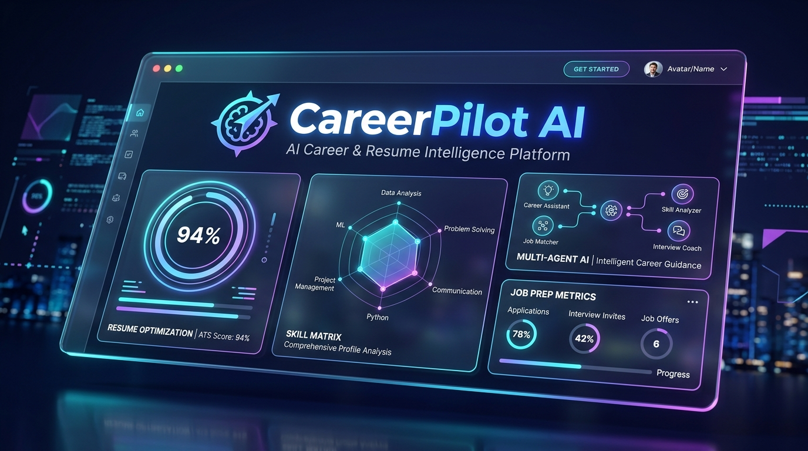
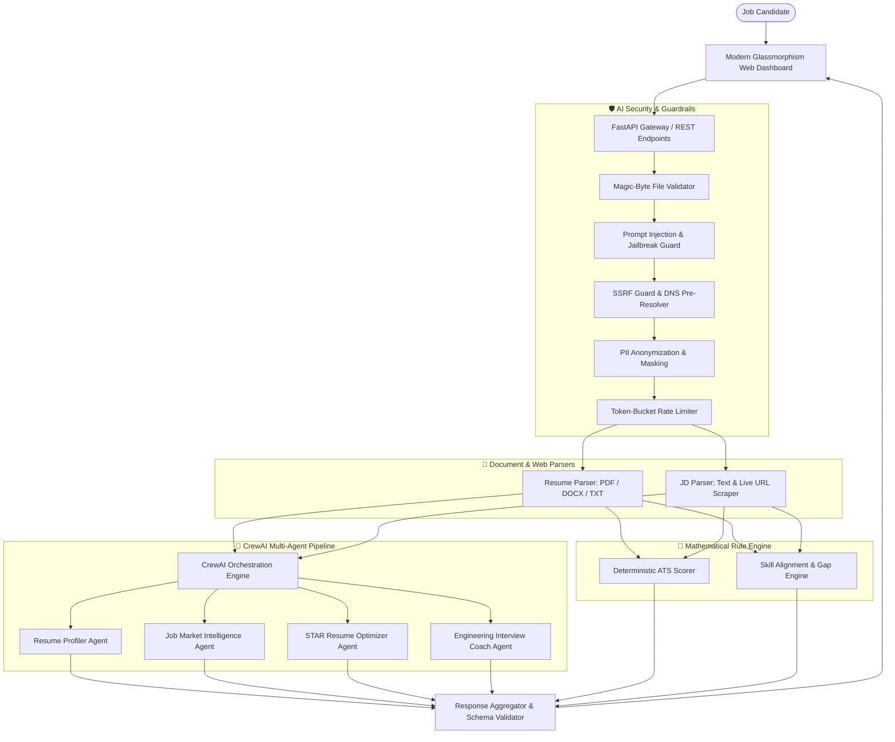

# CareerPilot AI — AI Resume Analyzer & Job Preparation System ⚡

<p align="center">
  
</p>

<p align="center">
  <a href="https://www.python.org/"></a>
  <a href="https://fastapi.tiangolo.com/"></a>
  <a href="https://www.crewai.com/"></a>
  <a href="https://render.com/"></a>
  <a href="https://www.docker.com/"></a>
  <a href="https://opensource.org/licenses/MIT"></a>
</p>

> **Autonomous Multi-Agent Career & Resume Intelligence Platform.**  
> Powered by **CrewAI**, a **deterministic ATS scoring engine**, **multi-format document parsers**, and **enterprise AI security guardrails**. Evaluates resumes against any target Job Description or live job URL, identifies skill gaps, rewrites experience using the STAR methodology, and generates company-specific interview preparation strategies.

---

## 📑 Table of Contents

- [Overview](#-overview)
- [Key Features](#-key-features)
- [System Architecture](#-system-architecture)
- [Multi-Agent Design (CrewAI)](#-multi-agent-design-crewai)
- [Deterministic ATS Scoring Engine](#-deterministic-ats-scoring-engine)
- [AI Security & Guardrails](#-ai-security--guardrails)
- [Tech Stack](#-tech-stack)
- [Quickstart & Installation](#-quickstart--installation)
- [Environment Configuration](#-environment-configuration)
- [Live Cloud Deployment](#-live-cloud-deployment)
- [Testing & Quality Assurance](#-testing--quality-assurance)
- [Interview & Engineering Talking Points](#-interview--engineering-talking-points)
- [License](#-license)

---

## 🌟 Overview

Applying for jobs with generic resumes and opaque Applicant Tracking Systems (ATS) is frustrating. Most existing AI resume builders are simple single-prompt wrappers that hallucinate metrics or invent skills that the candidate never had.

**CareerPilot AI** solves this through a robust **Multi-Agent Architecture**:
1. **Fact-Grounded Analysis:** Never fabricates qualifications or credentials.
2. **Deterministic Mathematical Scoring:** Calculates objective ATS compatibility scores instead of relying on subjective LLM guesses.
3. **Actionable Career Intelligence:** Pinpoints missing skills, provides custom learning roadmaps, tailors bullets using STAR/XYZ formulas, and synthesizes real-world company interview patterns.
4. **Enterprise Defense in Depth:** Shields the pipeline against prompt injection, SSRF exploits during URL scraping, and PII leakage.

---

## 🚀 Key Features

### 1. 📊 Deterministic ATS Scoring & Detailed Breakdown
- Multi-format ingestion supporting **PDF, DOCX, TXT, and Markdown** resumes.
- Weighted scoring rubric evaluating:
  - **Keyword Coverage (35%):** Exact & fuzzy keyword matching against job requirements.
  - **Technical Alignment (25%):** Hard skills, toolchains, frameworks, and architecture match.
  - **Experience & Impact (20%):** Quantifiable metrics ($ / % / numbers), action verbs, and seniority level.
  - **Education & Domain (10%):** Degree and industry specialization fit.
  - **Formatting & ATS Readability (10%):** Section headers, contact data, clean hierarchy.

### 2. 🛠 Skill Matrix & Intelligent Gap Analysis
- Categorizes all skills into:
  - **✅ Matched Skills:** Verified strengths already in the resume.
  - **⚠️ Partial Matches:** Related concepts or foundational skills that can be highlighted.
  - **❌ Missing Skills:** High-priority requirements missing from the profile.
- Generates a **step-by-step learning roadmap** with actionable recommendations.

### 3. 📄 STAR-Method Tailored Resume Optimization
- Transforms weak, passive resume bullet points into high-impact **Situation - Task - Action - Result (STAR)** accomplishments.
- Strict anti-hallucination constraint: strictly rewrites existing experiences without inventing fictional jobs or responsibilities.
- Generates copy-ready, ATS-optimized Markdown bullets with quantifiable impact.

### 4. 🎤 Company Interview Patterns & Mock Simulator
- Researches company-specific interview themes, question patterns, and technical bar-raiser expectations.
- Generates categorized practice questions:
  - **Core Technical & Architecture**
  - **Behavioral & Leadership**
  - **System Design / Problem Solving**
- **Interactive Mock Simulator:** Users can input answers to receive instant rubric-based evaluations with constructive improvement feedback.

---

## 🏛️ System Architecture



---

## 🤖 Multi-Agent Design (CrewAI)

| Agent | Specialized Role | Goal & Responsibilities |
| :--- | :--- | :--- |
| **Senior Resume Profiler** | Candidate Competency Auditor | Thoroughly inspects candidate background, extracting verified technical proficiencies, architectures, and career trajectory without hallucination. |
| **Tech Job Market Specialist** | Role & Market Deconstructor | Deconstructs job descriptions or scraped job URLs into hard prerequisites, tech stacks, soft competencies, and seniority expectations. |
| **Principal Resume Strategist** | STAR / XYZ Career Optimizer | Rewrites candidate accomplishments into high-impact, measurable STAR statements strictly grounded in factual history. |
| **Engineering Interview Coach** | Bar Raiser & Pattern Specialist | Formulates company-tailored technical & behavioral interview questions and conducts automated answer evaluations. |

---

## 📐 Deterministic ATS Scoring Engine

Unlike standard AI wrappers that ask an LLM to *"Rate this resume from 1 to 100"* (which yields fluctuating, non-reproducible numbers), CareerPilot AI employs a **deterministic scoring algorithm**:

$$\text{ATS Score} = (0.35 \times K) + (0.25 \times T) + (0.20 \times E) + (0.10 \times D) + (0.10 \times F)$$

Where:
* **$K$ (Keyword Coverage):** Exact and semantic frequency match across required skills.
* **$T$ (Technical Alignment):** Hard competency overlap against candidate skills.
* **$E$ (Experience & Impact):** Density of quantifiable impact metrics (e.g. percentages, currency, scale) and strong action verbs.
* **$D$ (Education & Domain):** Degree level, certifications, and industry domain alignment.
* **$F$ (Formatting Integrity):** Standard section headers (Experience, Skills, Education), structural clarity, and contact info completeness.

---

## 🛡️ AI Security & Guardrails

Built with production safety principles aligned with the **OWASP Top 10 for LLM Applications**:

1. **Prompt Injection & Jailbreak Defense (`prompt_guard.py`):**
   - Scans user documents and job descriptions for prompt override triggers (e.g., `"ignore previous instructions"`, `"you are now in developer mode"`).
   - Encloses external text within inert XML containers (`<UNTRUSTED_DOCUMENT_DATA>`).
2. **SSRF Mitigation with DNS Pre-Resolution (`ssrf_guard.py`):**
   - When scraping job descriptions via URL, resolves DNS before dispatch to block loopback (`127.0.0.1`), private subnets (`10.0.0.0/8`, `172.16.0.0/12`, `192.168.0.0/16`), and AWS/GCP metadata endpoints (`169.254.169.254`).
3. **Magic-Byte Signature Verification (`file_validator.py`):**
   - Inspects file binary signatures (`%PDF-`, `PK\x03\x04`) rather than relying on file extensions alone, preventing malicious executable uploads.
4. **PII Anonymization (`pii_sanitizer.py`):**
   - Redacts sensitive personal information (emails, phone numbers) before processing external LLM traces.
5. **Token-Bucket Rate Limiter (`rate_limiter.py`):**
   - Protects API endpoints from abuse and brute-force flooding.

---

## 🛠️ Tech Stack

- **Core Language:** Python 3.12
- **Agent Framework:** CrewAI
- **Backend API:** FastAPI, Uvicorn, Pydantic v2
- **LLM Integrations:** Google Gemini 1.5/2.0 Flash (Primary), Groq Llama 3.3 70B (Fallback), OpenRouter
- **Parsers & Scraping:** `PyPDF2`, `python-docx`, `beautifulsoup4`, `urllib3`
- **Frontend:** Responsive Glassmorphism UI (HTML5, Vanilla ES6 JavaScript, Tailwind CSS, Lucide Icons)
- **Containerization & CI/CD:** Docker (Multi-stage non-root build), Docker Compose, GitHub Actions
- **Cloud Hosting:** Render, Railway

---

## ⚙️ Quickstart & Installation

### Prerequisites
- Python 3.10+ (Python 3.12 recommended)
- Git

### 1. Clone Repository & Create Virtual Environment
```bash
git clone https://github.com/Aswinbose05/Resume_Job_Prepare.git
cd Resume_Job_Prepare

# Create virtual environment
python -m venv venv

# Activate virtual environment
# On Windows:
venv\Scripts\activate
# On macOS / Linux:
source venv/bin/activate

# Install dependencies
pip install -r requirements.txt
```

### 2. Configure Environment Variables
Create a `.env` file from the example:
```bash
cp .env.example .env
```
Add your free Gemini API key (or Groq API key):
```env
GEMINI_API_KEY=your_gemini_api_key_here
PRIMARY_LLM_PROVIDER=gemini
PORT=8000
```

### 3. Launch the Application
```bash
python run.py
```
Visit **`http://localhost:8000`** in your browser.

---

## ☁️ Live Cloud Deployment

### Deploy on Render.com (100% Free)
The repository includes a production-ready `render.yaml` blueprint and `Dockerfile`:
1. Push your repository to GitHub.
2. Sign in to [render.com](https://render.com) and click **New +** &rarr; **Web Service**.
3. Select your `Resume_Job_Prepare` repository.
4. Set:
   - **Environment:** `Docker` (or `Python 3`)
   - **Health Check Path:** `/healthz` (or `/api/health`)
   - **Environment Variables:**
     - `GEMINI_API_KEY`: *Your API Key*
     - `PRIMARY_LLM_PROVIDER`: `gemini`
5. Click **Deploy Web Service**.

### Deploy with Docker
```bash
# Build the container image
docker build -t careerpilot-ai .

# Run the container
docker run -d -p 8000:8000 -e GEMINI_API_KEY="your_api_key" careerpilot-ai
```

---

## 🧪 Testing & Quality Assurance

The codebase includes comprehensive unit, evaluation, and security test suites:
```bash
# Run all tests
pytest resume-tailor-ai/tests/ -v
```

**Test Coverage Areas:**
- `test_parsers.py`: PDF, DOCX, and TXT parsing integrity, corrupt file handling.
- `test_engine.py`: Deterministic scoring mathematical stability and keyword accuracy.
- `test_security.py`: Prompt injection blocking, SSRF IP filtering, PII sanitization.
- `test_crew_pipeline.py`: CrewAI agent execution, task synchronization, anti-hallucination checks.
- `test_evaluation.py`: End-to-end benchmark evaluation.

---

## 💼 Interview & Engineering Talking Points

*When presenting this project in technical interviews:*

1. **Deterministic Scoring vs. LLM Hallucination:**  
   *"Rather than asking an LLM for an arbitrary score that varies on every request, we decoupled evaluation into a deterministic mathematical engine. The LLM handles nuanced contextual tailoring (STAR bullets, interview strategies), while deterministic regex/AST algorithms compute verified keyword densities and metrics."*

2. **Multi-Agent Decomposition with CrewAI:**  
   *"We avoided monolithic prompts by assigning distinct personas with explicit task boundaries: the Resume Profiler audits existing facts, the Job Specialist extracts hard requirements, the Optimizer handles STAR rewrites, and the Coach focuses on interview prep."*

3. **Production Security Guardrails:**  
   *"Resumes and scraped job URLs represent untrusted external input. We implemented multi-tier defense: binary magic-byte inspection against disguised payloads, Prompt Guard to neutralize prompt injections, and DNS pre-resolution SSRF protection preventing access to cloud metadata endpoints."*

4. **Multi-Tier LLM Resilience:**  
   *"The platform is designed to operate seamlessly on free-tier infrastructure. If Google Gemini reaches rate limits (HTTP 429), the gateway gracefully falls back to Groq Llama 3.3 70B, with deterministic rule-based evaluation ensuring zero service downtime."*

---

## 📄 License

Distributed under the **MIT License**. See `LICENSE` for more information.

---

<p align="center">
  <b>Built with ❤️ using CrewAI, FastAPI, and Python.</b>
</p>
